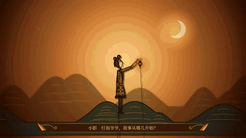
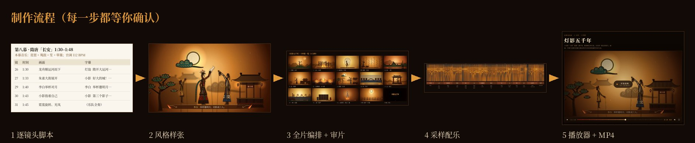
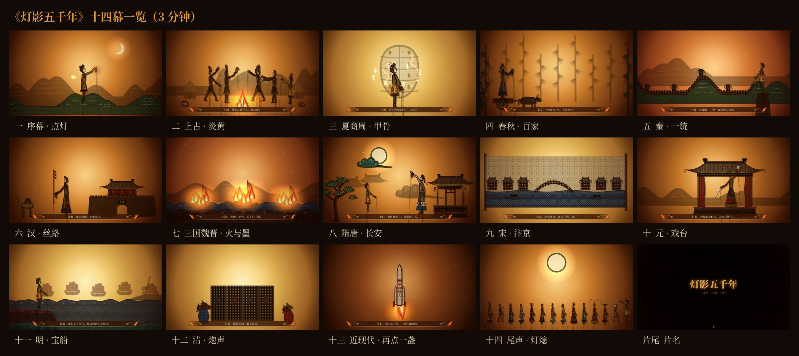
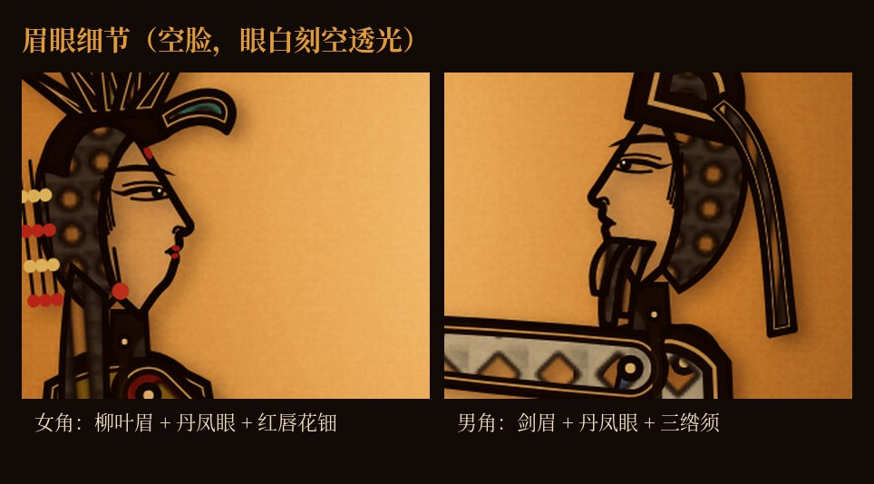
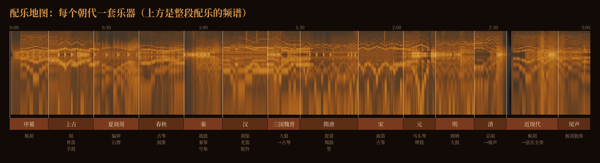
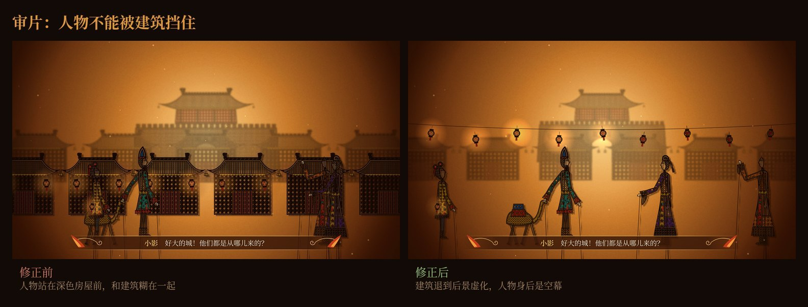

# 皮影戏动画技能（shadow-puppet-animation）



一个给 Claude Code 和 Codex 用的技能：一句话描述想要的故事，就能用代码做出一部中国皮影戏风格的动画短片。画面、字幕和配乐全部由程序生成。

本页展示《灯影五千年》的制作案例：原说明标注为 3 分钟、14 幕，从炎黄一路讲到登月。下方动图、图解和配乐片段均提取自随附的 HTML 演示文档。

> 动图与图片可直接在支持 Markdown 图片预览的工具中查看。配乐请点击链接试听；上传或分享时，请把 `README.md` 和 `assets/` 文件夹一起保留。

🎧 试听配乐片段（37 秒）

[播放／下载配乐试听（MP3）](assets/music-preview.mp3)

## 它能做出什么

| 产出 | 说明 |
| --- | --- |
| 逐镜头脚本 | 脚本文档，每个镜头写明时间、画面、“角色名 + 台词”的字幕和音效；每一幕单独写音乐（乐器、调式、速度、参考曲） |
| 风格样张 | 正式制作前先渲染 1–2 张画面给你确认 |
| 网页播放器 | 单个 HTML 页面，有播放/暂停、进度条、章节跳转、静音、全屏，配乐内嵌 |
| MP4 视频 | 可按需求导出 1080p / 30fps 视频，并另做较小体积的 720p 版本；具体以运行环境和交付要求为准 |



成片的 14 幕：



## 画风

按真实皮影的样子来做，不是扁平的彩色插画：

- 以深色牛皮为底，红、绿、黄、蓝是半透明的染色块。
- 花纹是真正刻穿的孔，后面的幕光会透出来。
- 每块皮子的边缘都是“深色—透光细缝—深色”的阳刻双线。
- 人物修长，头身比约 1:9。脸部刻空，只留侧面轮廓线，配丹凤眼和柳叶眉。
- 每个人偶露出三根操纵签子（脖颈一根、两手各一根）。
- 背景是一块透光的橙黄纯色幕，楼阁、树、云、船等景片也是镂空皮子；远处的景片做虚化。

画风经过三版才定下来，每一版都先给用户看样张：


眉眼是单独打磨过的，放大后能看清刻工：



## 配乐

每个朝代换一套乐器、调式和速度，用一段主题旋律贯穿全片。乐器是真实乐器的采样，不是电子合成：



## 审片

全片做完后会逐个镜头检查，人物身后不能压着深色建筑，人物之间也不能重叠：



## 网页播放器


## 安装

把整个技能文件夹复制到所用工具的技能目录，并将安装文件夹命名为 `shadow-puppet-animation`：

| 工具 | 本地安装目录 |
| --- | --- |
| Claude Code | `~/.claude/skills/shadow-puppet-animation/` |
| Codex | `~/.agents/skills/shadow-puppet-animation/` |

`~` 表示当前用户主目录。安装后，文件夹第一层应直接包含 `SKILL.md`、`README.md`、`assets/` 和 `references/`，不要再套一层同名文件夹。保留整个目录，重新打开工具后，在对话中说明“使用 shadow-puppet-animation 技能”。

## 怎么用

直接跟 Claude Code 或 Codex 说想做什么，例如：

- “做一个皮影戏动画，讲中国五千年历史，三分钟”
- “用皮影戏的形式讲《西游记》三打白骨精，两分钟”
- “做一段皮影风格的春节短片”

一次对话大致是这样的：

> **你**：用皮影戏讲《西游记》三打白骨精，两分钟。
>
> **AI**：先写脚本。（生成逐镜头脚本文档：10 幕，每个镜头有时间、画面和“悟空　妖精，吃俺老孙一棒！”这样的字幕，每幕写好配乐）
>
> **你**：第三幕太长了，白骨精变老婆婆那段再加一句台词。
>
> **AI**：（改好脚本）现在出一张风格样张给你看。（发来渲染好的画面）
>
> **你**：再暗一点，悟空的眼睛要更有神。
>
> **AI**：（调整后重发样张）……确认后开始做全片，配乐，最后发网页播放器和 MP4。

可以要求 AI 按下面的顺序推进：先确认脚本和画风，再制作全片，最后审片交付。

1. 写逐镜头脚本 → 你看过再改
2. 渲染风格样张 → 你确认明暗、刻工和眉眼
3. 制作全片画面和字幕，逐镜头检查人物有没有被建筑挡住
4. 用采样乐器编配、混音配乐
5. 发布网页播放器，导出并发送 MP4

想改的地方随时说，比如“再暗一点”“眼睛不够精致”“这里人被挡住了”“配乐不好听”。

## 目录结构

```text
shadow-puppet-animation/
├── README.md                 本说明
├── SKILL.md                  技能正文
├── assets/                   从提供的 HTML 原样提取的演示素材
│   ├── demo.gif              成片片段动图
│   ├── music-preview.mp3     配乐试听
│   ├── workflow.jpg          制作流程
│   ├── fourteen-scenes.jpg   十四幕一览
│   ├── style-iterations.jpg  画风迭代
│   ├── eye-details.jpg       眉眼细节
│   ├── music-map.jpg         配乐地图
│   ├── occlusion-fix.jpg     遮挡修正前后
│   └── player.jpg            播放器截图
└── references/
    └── samples/
        ├── ref_01.png        全景样张
        └── ref_02.png        人物近景样张
```

本包包含技能说明、两张参考样张，以及本页的演示素材。演示播放器截图不是可运行的播放器，完整视频和动画工程也未随包提供。原 HTML 提到的实物照片、参考视频和早期样张不在当前包中，本次没有补入。

## 运行环境

制作动画时会用到以下工具。首次运行请让 AI 检查环境，再按实际需要安装缺少的依赖：

- Chromium + Playwright：逐帧渲染画面、截图检查、导出视频帧
- ffmpeg：解码音源、编码 MP4、压缩视频
- Python（numpy、scipy）：配乐的离线混音
- 网络能访问 GitHub：配乐所需的乐器采样从 GitHub 上的 MIDI.js 音源库下载

## 已知限制

- 原案例为方便交付制作了较小体积的 720p 版本。文件大小限制取决于使用的平台，可按需压缩或分段。
- 3 分钟、30fps 的成片需要渲染约 5400 帧；导出和编码耗时取决于设备、场景复杂度和运行环境。
- 民族乐器用的是最接近的通用采样（例如用尺八代替箫、陶笛代替埙、三味线代替琵琶），音色和真实民乐有差距。
- 网页播放器在性能较弱的设备上可能掉帧，视频版不受影响。

## 素材来源与版权

- **乐器采样**：来自 gleitz/midi-js-soundfonts 的 MusyngKite 音源。商用或公开发布作品前，请自行核对该音源的许可条款。
- **参考图与参考视频**：当前包保留两张样张，用于画风与构图参考；原说明中提到的实物照片和参考短片未包含在这个包中。
- **画面与配乐编曲**：按所提供 HTML 的说明由程序生成。本次 `assets/` 中的图片、动图与音频均从该 HTML 原样提取，没有重新生成或从外部补充素材。
